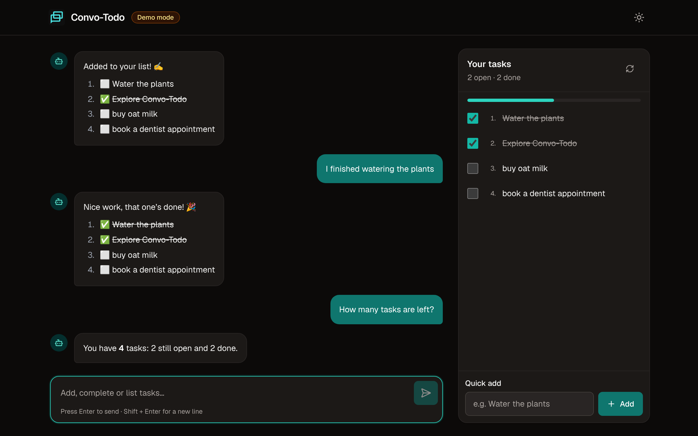
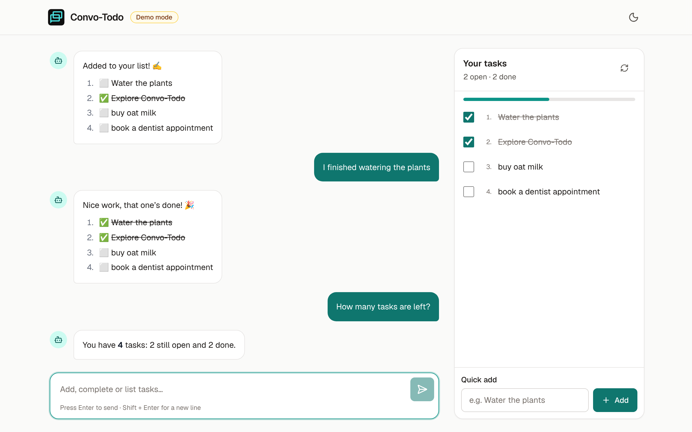
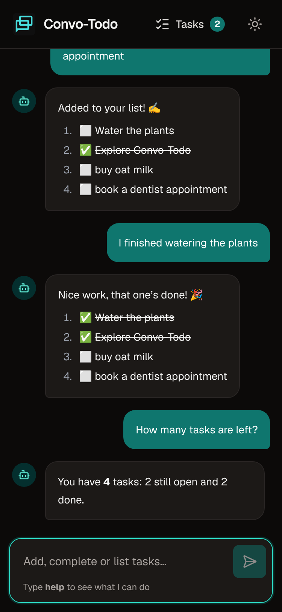
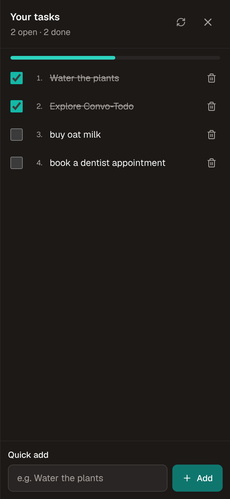
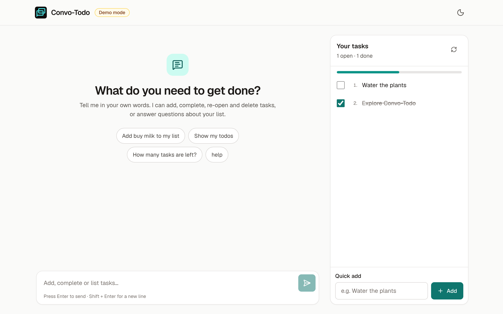
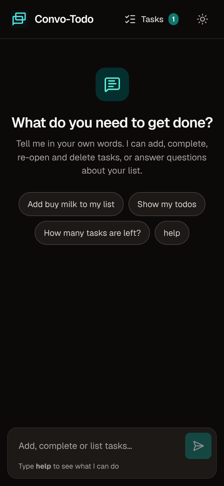
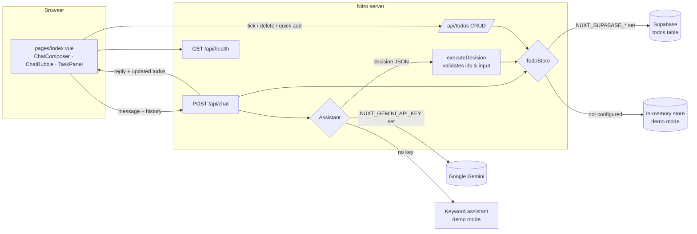

# Convo-Todo

**A to-do list you can talk to.** Add, complete, re-open, delete and ask about your tasks in plain
language, and an AI assistant turns what you say into real changes to your list.




## Overview

Most to-do apps make you click through forms. Convo-Todo lets you just say what you need:
_"remind me to book a dentist appointment"_, _"I finished watering the plants"_ or _"how many
tasks are left?"_. The message goes to Google Gemini, which decides whether you are chatting or
asking for a change. Changes are checked on the server and then applied to a Supabase (Postgres)
table. A task panel next to the chat shows the list as it changes, and you can also tick, delete
and add tasks there directly.

It's for anyone who would rather type a sentence than fill in a form, and it also works as a small,
readable example of building an LLM "intent → action" feature with Nuxt server routes.

> This repository is a fork of **Convo-Todo** by [Sumir Seth](https://github.com/sumirseth). The
> original idea, prompts and first implementation are theirs.

## Screenshots

| Desktop, light theme                                            | Phone (375 px)                                       | Phone task panel                                      |
| --------------------------------------------------------------- | ---------------------------------------------------- | ----------------------------------------------------- |
|  |        |  |
|   |  |                                                       |

<sub>These were captured from the running app in **demo mode**, which uses the keyword-based
assistant and in-memory storage. With a Gemini key, the replies come from the model and read more
naturally.</sub>

## Features

- **Natural-language task management.** Add, list, complete, re-open and delete tasks by chatting.
  You can refer to a task by its name (fuzzy matching) or by its number in the list.
- **Questions about your list.** Ask things like "how many are left?" or "what did I add last?",
  and the assistant answers from your current tasks without changing anything.
- **Safe execution.** The server reads the task list itself and only acts on ids that exist, so a
  hallucinated id can never delete the wrong row. Inputs are validated and length-limited.
- **Structured model output.** Gemini runs in JSON mode with a response schema, plus a parser that
  tolerates code fences and stray text.
- **Short conversation memory.** The last 10 messages are sent along, so follow-ups like "delete
  that one too" work.
- **Live task panel.** A sidebar on desktop and a slide-over on phones and tablets, with a progress
  bar, checkboxes, delete buttons and a validated quick-add form.
- **Demo mode with no keys needed.** Without Gemini or Supabase credentials, the app falls back to a
  keyword-based assistant and in-memory storage, and shows a "Demo mode" badge in the header.
- **Polished UI.** Light and dark themes (follows the system setting, with a toggle), a responsive
  layout from 375 px up, sanitised Markdown replies, loading/empty/error states, a custom 404 page,
  and accessible markup (labelled controls, live regions, visible focus rings, skip link, reduced
  motion support).

## Tech stack

| Layer      | Technology                                                                     |
| ---------- | ------------------------------------------------------------------------------ |
| Framework  | [Nuxt 3](https://nuxt.com) (Vue 3, Nitro server routes), TypeScript (strict)   |
| Styling    | Tailwind CSS 3, `@tailwindcss/typography`, Geist (self-hosted via Fontsource)  |
| UI helpers | `@nuxt/icon` (Lucide icons, bundled), `@nuxtjs/color-mode`                     |
| AI         | Google Gemini via `@google/generative-ai` (default model `gemini-2.5-flash`)   |
| Database   | Supabase Postgres via `@supabase/supabase-js` (server-side only)               |
| Markdown   | `marked` with a custom renderer that escapes HTML and filters out unsafe links |
| Tooling    | pnpm, ESLint (`@nuxt/eslint`), Prettier, Vitest, `vue-tsc`                     |

## Architecture



How a chat message is handled:

1. The browser sends `{ message, history }` to `POST /api/chat`.
2. The server loads the current todos from the store. The client's copy is never trusted.
3. The assistant gets a system prompt that includes the todo list (marked as data, not
   instructions) and returns a decision: `{"type":"chat","reply":…}` or
   `{"type":"action","action":"mark_todo_completed","id":7,"reply":…}`.
4. `executeDecision` validates the decision (the id must exist, task text must be non-empty and at
   most 300 characters), runs it against the store and appends the updated list to the reply.
5. The browser shows the reply as sanitised Markdown and refreshes the task panel from the returned
   `todos`.

Secrets (`NUXT_GEMINI_API_KEY`, `NUXT_SUPABASE_KEY`) live in Nuxt's **private** runtime config and
are never sent to the browser.

## Project structure

```text
.
├── app.vue                     # Root component (renders the current page)
├── error.vue                   # 404 / error page
├── pages/
│   └── index.vue               # Main screen: chat + task panel / slide-over
├── components/
│   ├── AppHeader.vue           # Logo, demo-mode badge, actions slot, theme toggle
│   ├── ChatBubble.vue          # One message (sanitised Markdown)
│   ├── ChatComposer.vue        # Auto-growing textarea with validation hint
│   ├── TaskPanel.vue           # Task list, progress, quick add, loading/empty/error states
│   ├── ThemeToggle.vue         # Light/dark switch
│   └── TypingIndicator.vue     # "Assistant is typing…" bubble
├── composables/
│   ├── useChat.ts              # Conversation state, calls POST /api/chat
│   ├── useTodos.ts             # Shared todo state + REST helpers
│   └── useApiError.ts          # Turns fetch errors into friendly messages
├── utils/
│   └── markdown.ts             # Safe Markdown renderer used with v-html
├── server/
│   ├── api/
│   │   ├── chat.post.ts        # Chat → decision → action
│   │   ├── health.get.ts       # Which backends are active
│   │   └── todos/              # REST CRUD: index.get, index.post, [id].patch, [id].delete
│   └── utils/
│       ├── assistant.ts        # Prompt, output parsing, validation, keyword assistant, executor
│       ├── gemini.ts           # Gemini client with a JSON response schema
│       ├── todo-store.ts       # TodoStore interface + Supabase and in-memory stores
│       ├── services.ts         # Picks the store/assistant from runtime config
│       └── errors.ts           # Maps errors to HTTP responses without leaking internals
├── types/todo.ts               # Types shared by client and server
├── assets/css/main.css         # Tailwind layers + design tokens (buttons, cards, inputs)
├── tests/                      # Vitest unit tests
├── docs/screenshots/           # README screenshots (captured from the running app)
└── public/                     # favicon, Open Graph image, robots.txt
```

## Getting started

### Prerequisites

- **Node.js 20 or newer** (an `.nvmrc` is included)
- **pnpm 9** (`corepack enable` will pick up the version pinned in `package.json`)
- Optional: a [Google AI Studio](https://aistudio.google.com/app/apikey) API key for Gemini
- Optional: a [Supabase](https://supabase.com) project for persistent storage

### Installation

```bash
git clone https://github.com/jeevithg090/Chat-bot1232.git
cd Chat-bot1232
pnpm install
cp .env.example .env   # then fill in the values you have
pnpm dev               # http://localhost:3000
```

With an empty `.env` the app starts in **demo mode**, so you can try it straight away.

### Database setup (Supabase)

Create the table in the Supabase SQL editor:

```sql
create table public.todos (
  id          bigint generated by default as identity primary key,
  content     text        not null,
  completed   boolean     not null default false,
  created_at  timestamptz not null default now()
);
```

Then set `NUXT_SUPABASE_URL` and `NUXT_SUPABASE_KEY`. The key is only used on the server. If you
use the `anon` key, add Row Level Security policies that allow `select`, `insert`, `update` and
`delete` on `todos`. If you use the `service_role` key (which bypasses RLS), keep it strictly
server-side, as this app does. See [Known limitations](#known-limitations) about multi-user use.

## Configuration

All variables are read at runtime on the server. Nuxt maps `NUXT_*` variables onto
`runtimeConfig`.

| Variable              | Required | Default            | Description                                                                        |
| --------------------- | -------- | ------------------ | ---------------------------------------------------------------------------------- |
| `NUXT_GEMINI_API_KEY` | No\*     | _(empty)_          | Google Gemini API key. If unset, the keyword-based demo assistant is used.         |
| `NUXT_GEMINI_MODEL`   | No       | `gemini-2.5-flash` | Gemini model name to call.                                                         |
| `NUXT_SUPABASE_URL`   | No\*     | _(empty)_          | Supabase project URL, e.g. `https://xyz.supabase.co`.                              |
| `NUXT_SUPABASE_KEY`   | No\*     | _(empty)_          | Supabase API key (server-only). If URL or key is unset, in-memory storage is used. |
| `NUXT_SUPABASE_TABLE` | No       | `todos`            | Name of the table that stores todos.                                               |
| `PORT` / `HOST`       | No       | `3000` / `0.0.0.0` | Where the production server listens (standard Nitro variables).                    |

\* Required for real use. Without them the app runs, but in demo mode.

## Running

| Mode        | Command                      | Notes                                         |
| ----------- | ---------------------------- | --------------------------------------------- |
| Development | `pnpm dev`                   | Hot reload on http://localhost:3000           |
| Production  | `pnpm build && pnpm start`   | Runs `.output/server/index.mjs` (Node server) |
| Preview     | `pnpm build && pnpm preview` | Previews the production build locally         |

Environment variables are picked up from `.env` in development. In production, set them in your
host's environment (`pnpm start` doesn't read `.env`).

## Usage

### In the browser

1. Open the app. The welcome screen offers example prompts such as **Show my todos** and **help**.
2. Type a request and press **Enter** (**Shift + Enter** adds a new line).
3. The reply appears in the chat and the task panel updates. On phones, tap **Tasks** in the header
   to open the panel. **Esc** or the close button closes it.
4. In the panel, tick a checkbox to complete or re-open a task, use the trash icon to delete it, or
   type in **Quick add**.

Things you can say:

| You say                                     | What happens                         |
| ------------------------------------------- | ------------------------------------ |
| "Add buy oat milk"                          | Creates the task                     |
| "Remind me to book a dentist appointment"   | Creates "book a dentist appointment" |
| "Show my todos" / "What's on my list?"      | Lists all tasks                      |
| "I finished watering the plants"            | Marks the matching task as done      |
| "Mark task 2 as not done" / "Undo call mum" | Re-opens a task                      |
| "Delete the milk task" / "Remove 3"         | Deletes a task                       |
| "How many tasks are left?"                  | Answers from your list, no change    |
| "help"                                      | Shows what the assistant can do      |

### Over HTTP

```bash
curl -s -X POST http://localhost:3000/api/chat \
  -H 'content-type: application/json' \
  -d '{"message": "Add buy oat milk"}'
```

```json
{
  "reply": "Added to your list! ✍️\n\n1. ⬜️ Water the plants\n2. ✅ ~~Explore Convo-Todo~~\n3. ⬜️ buy oat milk",
  "action": "add_todo",
  "todos": [
    {
      "id": 1,
      "content": "Water the plants",
      "completed": false,
      "created_at": "2026-11-14T22:09:15.471Z"
    },
    {
      "id": 2,
      "content": "Explore Convo-Todo",
      "completed": true,
      "created_at": "2026-11-14T22:09:15.472Z"
    },
    {
      "id": 3,
      "content": "buy oat milk",
      "completed": false,
      "created_at": "2026-11-14T22:09:15.505Z"
    }
  ]
}
```

(This response came from demo mode. Gemini writes its own confirmation text.)

```bash
curl -s -X PATCH http://localhost:3000/api/todos/3 \
  -H 'content-type: application/json' -d '{"completed": true}'
# {"todo":{"id":3,"content":"buy oat milk","completed":true,"created_at":"…"}}
```

Errors use Nuxt's standard error shape:

```json
{
  "error": true,
  "statusCode": 400,
  "statusMessage": "Bad Request",
  "message": "Please type a message."
}
```

## API reference

None of the endpoints require authentication (see [Known limitations](#known-limitations)).

| Method   | Path             | Auth | Body                                    | Description                                                              |
| -------- | ---------------- | ---- | --------------------------------------- | ------------------------------------------------------------------------ |
| `POST`   | `/api/chat`      | None | `{ message: string, history?: Turn[] }` | Sends a message. Returns `{ reply, action, todos }`.                     |
| `GET`    | `/api/todos`     | None | –                                       | Lists todos, oldest first. Returns `{ todos }`.                          |
| `POST`   | `/api/todos`     | None | `{ content: string }`                   | Creates a todo (≤ 300 chars). Returns `201 { todo }`.                    |
| `PATCH`  | `/api/todos/:id` | None | `{ completed: boolean }`                | Completes or re-opens a todo. Returns `{ todo }`, or 404.                |
| `DELETE` | `/api/todos/:id` | None | –                                       | Deletes a todo. Returns the deleted `{ todo }`, or 404.                  |
| `GET`    | `/api/health`    | None | –                                       | `{ status, storage: "supabase"\|"memory", assistant: "gemini"\|"demo" }` |

`Turn` is `{ role: "user" | "assistant", text: string }`. At most the last 10 turns are used.
`message` is limited to 1000 characters.

## Scripts

| Script              | What it does                                               |
| ------------------- | ---------------------------------------------------------- |
| `pnpm dev`          | Start the dev server with hot reload                       |
| `pnpm build`        | Production build into `.output/`                           |
| `pnpm start`        | Run the production build                                   |
| `pnpm preview`      | Preview the production build                               |
| `pnpm generate`     | Static generation (not useful here: the app needs its API) |
| `pnpm test`         | Run the unit tests once                                    |
| `pnpm test:watch`   | Run the tests in watch mode                                |
| `pnpm lint`         | ESLint                                                     |
| `pnpm lint:fix`     | ESLint with auto-fix                                       |
| `pnpm format`       | Format everything with Prettier                            |
| `pnpm format:check` | Check formatting without writing                           |
| `pnpm typecheck`    | Type-check with `vue-tsc`                                  |

## Testing

```bash
pnpm test
```

The Vitest suite (64 tests in `tests/`) covers the core logic without network access:

- **`assistant.test.ts`**: JSON extraction from model output, decision parsing (unknown actions
  and bad ids are rejected), request/id/task validation, the system prompt, list formatting, fuzzy
  task matching, and the keyword-based assistant.
- **`execute.test.ts`**: the in-memory store and `executeDecision` for every action, including
  hallucinated or missing ids and empty tasks.
- **`markdown.test.ts`**: the safe Markdown renderer (raw HTML is escaped, `javascript:`/`data:`
  links are stripped, images are not loaded).

The Gemini and Supabase adapters are thin wrappers and are not unit-tested against the real
services.

## Linting and formatting

ESLint uses the Nuxt flat config (`@nuxt/eslint`) together with `eslint-config-prettier`, and
Prettier formats the code (`.prettierrc.json`: no semicolons, single quotes, 100 columns). Run
`pnpm lint`, `pnpm format:check` and `pnpm typecheck` before opening a pull request.

## Deployment

Convo-Todo is a standard Nuxt 3 server app. It needs a Node runtime for the API routes, so plain
static hosting won't work.

**Any Node host (VM, Render, Railway, Fly.io, Docker…)**

```bash
pnpm install --frozen-lockfile
pnpm build
NUXT_GEMINI_API_KEY=… NUXT_SUPABASE_URL=… NUXT_SUPABASE_KEY=… PORT=3000 node .output/server/index.mjs
```

The `.output/` folder is self-contained, so you can copy it to the server on its own.

**Vercel / Netlify / Cloudflare.** Nitro detects these platforms and builds the right preset
automatically. Set the environment variables in the platform dashboard. Demo mode keeps data in
memory per server instance, so on serverless hosts always configure Supabase.

After deploying, open `/api/health` and check that it reports `"storage":"supabase"` and
`"assistant":"gemini"`.

## Troubleshooting / FAQ

<details>
<summary><strong>The header says "Demo mode" and replies feel robotic</strong></summary>

`NUXT_GEMINI_API_KEY` isn't reaching the server. In development, check `.env` and restart
`pnpm dev`. In production, set it in the host's environment. `/api/health` shows which backends
are active.

</details>

<details>
<summary><strong>My tasks disappear when the server restarts</strong></summary>

You're using the in-memory store. Set `NUXT_SUPABASE_URL` and `NUXT_SUPABASE_KEY` and create the
table shown above.

</details>

<details>
<summary><strong>"The database request failed" (HTTP 502)</strong></summary>

Supabase returned an error. Common causes: the table doesn't exist or has a different name (see
`NUXT_SUPABASE_TABLE`), the column names differ, or RLS blocks the `anon` key. The server log shows
the underlying Supabase message.

</details>

<details>
<summary><strong>"The assistant could not answer right now" (HTTP 500)</strong></summary>

The Gemini call failed. Check that the key is valid, the model in `NUXT_GEMINI_MODEL` is available
to your key, and you haven't hit a quota. The server log has the details.

</details>

<details>
<summary><strong><code>pnpm install</code> fails with "Unsupported engine"</strong></summary>

Use Node 20 or newer (`nvm use`).

</details>

## Known limitations

- **No authentication and one shared list.** Every visitor sees and edits the same todos. Don't
  expose a deployment publicly without adding auth (e.g. Supabase Auth plus a `user_id` column and
  RLS).
- **No rate limiting.** Each chat message costs a Gemini request. Put the app behind a rate
  limiter or auth before sharing it widely.
- **Prompt injection** can't be fully prevented. Task text is passed as data and the server
  re-validates every action, but a crafted task could still influence the model's wording.
- **Conversation history is not saved.** It lives in the browser tab and is gone on reload.
- The demo assistant only understands simple English command patterns.

## Roadmap ideas

- User accounts with per-user lists (Supabase Auth + RLS)
- Streaming replies
- Due dates, priorities and reminders the assistant can set
- Persisted conversation history
- Migrating to Google's newer `@google/genai` SDK
- End-to-end tests with Playwright

## Contributing

1. Fork the repo and create a branch: `git checkout -b feat/my-change`.
2. `pnpm install`, make your change, and add or adjust tests.
3. Make sure `pnpm lint`, `pnpm format:check`, `pnpm typecheck`, `pnpm test` and `pnpm build`
   all pass.
4. Use [Conventional Commits](https://www.conventionalcommits.org) (`feat:`, `fix:`, `docs:`…)
   and open a pull request.

## License and credits

Convo-Todo was created by **[Sumir Seth](https://github.com/sumirseth)**, and this repository is a
fork of their project. All credit for the original concept and implementation goes to them.

The repository doesn't include a license file yet, so all rights are reserved by default. If you
maintain this project, consider adding a permissive license such as **MIT**, after checking with
the original author.
